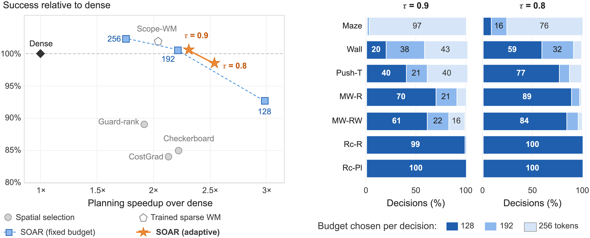
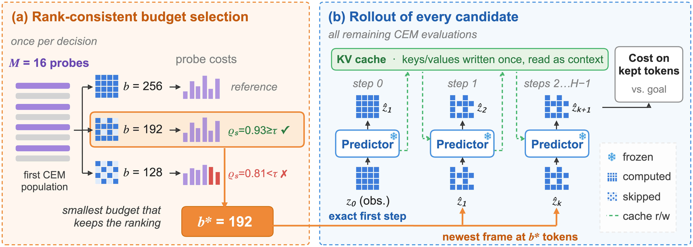
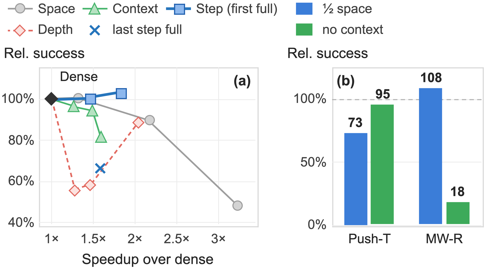

# SOAR: Training-Free Rank-Consistent Rollout Compression for Latent World Model Planning

[](LICENSE)
[](https://arxiv.org/abs/2611.27639)
[](https://github.com/starrywiki/SOAR/stargazers)
  
**Official repository for SOAR**, a training-free method for accelerating latent world-model planning by preserving candidate rankings rather than dense rollout features.

**Authors:** [Anqi Li](https://starrywiki.github.io/)<sup>1,&#42;</sup>, [Kai Liu](https://kai-liu.cn/)<sup>2,&#42;</sup>, [Linghe Kong](https://www.cs.sjtu.edu.cn/~linghe.kong/)<sup>2</sup>, [Yulun Zhang](https://yulunzhang.com/)<sup>2</sup>

<sup>1</sup> Zhiyuan College, Shanghai Jiao Tong University  
<sup>2</sup> Shanghai Jiao Tong University  
<sup>&#42;</sup> These authors contributed equally.

## News

- **November 2026:** SOAR is now available on [arXiv](https://arxiv.org/abs/2611.27639).

## Abstract

Latent world models repeatedly simulate candidate action sequences to plan, making inference expensive. In sampling-based planning, however, the planner uses predicted rollout costs primarily to **rank candidate actions**, not to reconstruct every latent feature accurately. SOAR exploits this distinction to compress computation while preserving the ordering that determines planning decisions.

SOAR keeps the first rollout step exact, reuses cached context representations, and selects a spatial-token budget independently at each planning decision using a small rank-consistency probe. It requires **no retraining or task labels**. Across seven navigation and manipulation tasks with frozen world-model checkpoints, SOAR achieves dense-level planning success at **2.31× speedup**, and retains **98% of dense success at 2.54× speedup**.

## Highlights

- **Rank-consistent compression.** Preserve the candidate ordering used by the cross-entropy method (CEM), rather than minimizing latent-feature distortion.
- **Exact first step.** Compute the observation-conditioned first rollout step in full, where errors otherwise propagate through subsequent predictions.
- **Cached context.** Reuse previous-frame keys and values instead of recomputing the context frame at every rollout step.
- **Adaptive per-decision budget.** Probe 16 candidate rollouts with token budgets of 256, 192, and 128 positions; choose the smallest budget meeting a Spearman rank-correlation threshold.
- **Training-free and task-agnostic.** Use released frozen JEPA-WM checkpoints, with no additional supervision or model training.

## Overview



SOAR adapts token budgets to the current decision: challenging decisions retain more spatial detail, while easier decisions use fewer tokens. The figure reports success relative to the dense planner and the distribution of chosen budgets across evaluation tasks.

## Method



At each planning decision, SOAR:

1. **Probes the first CEM population.** Evaluate 16 fixed candidates at the full 256-token budget and two reduced budgets, 192 and 128.
2. **Checks rank consistency.** Compare the candidate-cost rankings using Spearman correlation and select the smallest budget meeting the threshold (default **τ = 0.9**); otherwise fall back to 256.
3. **Rolls out efficiently.** Keep the first predictor step exact, read the context frame from the KV cache, and apply the selected budget to the newest frame at subsequent rollout steps.

This isolates rollout compression to a single adaptive budget while leaving the world-model parameters and CEM sampling procedure unchanged.

## Results

| Method | Success relative to dense | Planning speedup |
|:--|--:|--:|
| Dense baseline | 1.00 | 1.00× |
| SOAR, fixed 256 positions | 1.02 | 1.76× |
| SOAR, fixed 192 positions | 1.01 | 2.21× |
| SOAR, fixed 128 positions | 0.93 | 2.98× |
| **SOAR, adaptive (τ = 0.9)** | **1.01** | **2.31×** |
| SOAR, adaptive (τ = 0.8) | 0.98 | 2.54× |

*Results are from the paper's paired closed-loop evaluation, covering seven navigation and manipulation tasks. Values above 1.00 mean success exceeded the dense baseline in the measured episodes.*



The study shows that **when computation is spent matters more than which spatial tokens are selected**. Preserving the first step and caching temporal context improve the speed–quality trade-off, while the appropriate spatial budget differs by task and by decision.

## Code and Reproduction

The code will be released soon.

## Citation

If you find SOAR useful, please cite:

```bibtex
@misc{li2026soar,
  title={SOAR: Training-Free Rank-Consistent Rollout Compression for Latent World Model Planning},
  author={Li, Anqi and Liu, Kai and Kong, Linghe and Zhang, Yulun},
  year={2026},
  eprint={2611.27639},
  archivePrefix={arXiv},
  primaryClass={cs.RO},
  url={https://arxiv.org/abs/2611.27639}
}
```
## License

This repository is licensed under the [MIT License](LICENSE). Third-party models, datasets, and benchmarks retain their respective licenses.

## Acknowledgements

We thank the authors and maintainers of the released [JEPA-WM](https://github.com/facebookresearch/jepa-wms) world-model checkpoints and the open-source tools and benchmarks used in this study.
